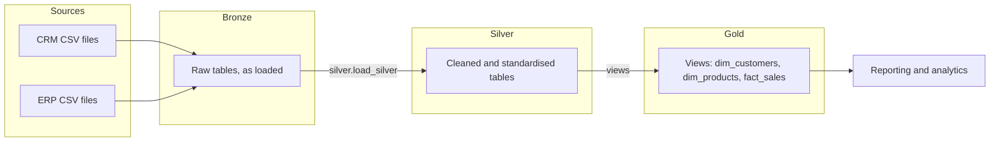
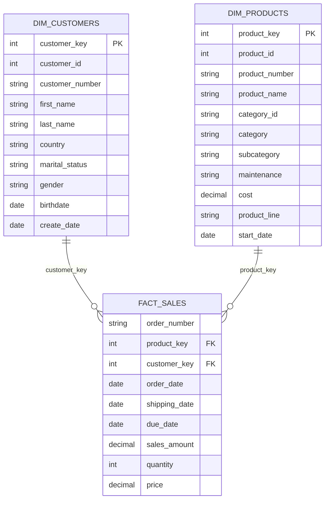

# MySQL Data Warehouse (Bronze → Silver → Gold)

A data warehouse built in **MySQL 8** using the **Medallion Architecture**. Raw CSV exports from two source systems (CRM and ERP) are loaded into a Bronze layer, cleaned and standardised in a Silver layer, and modelled into a **star schema** in the Gold layer for analytics and reporting.

---

## Table of Contents

1. [Architecture](#architecture)
2. [Source Data](#source-data)
3. [Repository Structure](#repository-structure)
4. [Layer Details](#layer-details)
5. [Data Quality Issues Found and How They Were Fixed](#data-quality-issues-found-and-how-they-were-fixed)
6. [Gold Layer Data Model](#gold-layer-data-model)
7. [How to Run](#how-to-run)
8. [Validation Queries](#validation-queries)
9. [Assumptions and Known Limitations](#assumptions-and-known-limitations)
10. [Tech Stack](#tech-stack)

---

## Architecture



| Layer | Purpose | Object type | Transformations |
|-------|---------|-------------|-----------------|
| **Bronze** | Raw data, exactly as received | Tables | None |
| **Silver** | Cleaned, standardised, deduplicated | Tables | Yes (stored procedure) |
| **Gold** | Business-ready star schema | Views | Joins, surrogate keys, business rules |

---

## Source Data

| System | Table | Description |
|--------|-------|-------------|
| CRM | `crm_cust_info` | Customer master data |
| CRM | `crm_prd_info` | Product master data with history |
| CRM | `crm_sales_details` | Sales transactions |
| ERP | `erp_cust_az12` | Extra customer data (birthdate, gender) |
| ERP | `erp_loc_a101` | Customer country |
| ERP | `erp_px_cat_g1v2` | Product categories |

---

## Repository Structure

> Adjust the file names to match your repository.

```
.
├── README.md
├── scripts/
│   ├── bronze/
│   │   └── ddl_bronze.sql              # Bronze table definitions and CSV load
│   ├── silver/
│   │   ├── ddl_silver.sql              # Silver table definitions
│   │   └── load_silver_mysql.sql       # Stored procedure silver.load_silver()
│   └── gold/
│       └── create_gold_views_mysql.sql # Gold views (star schema)
└── docs/
    └── (diagrams, data catalog)
```

---

## Layer Details

### Bronze

Raw tables loaded directly from the source CSV files with no changes. They are the single point of truth for what was received, and the Silver layer can always be rebuilt from them.

### Silver

Loaded by the stored procedure `silver.load_silver()`. For each table it **truncates, then inserts** transformed data from Bronze (full refresh). Progress and durations are returned as result sets, and any error is caught by an exit handler that returns the error message, number and SQLSTATE.

| Silver table | Transformations |
|--------------|-----------------|
| `crm_cust_info` | Remove rows with NULL or 0 `cst_id`; keep the **latest record per customer** (`ROW_NUMBER` by `cst_create_date DESC`); trim names; map marital status (`S`→Single, `M`→Married) and gender (`F`→Female, `M`→Male), else `n/a` |
| `crm_prd_info` | Split `prd_key` into `cat_id` (first 5 chars, `-` replaced with `_`) and the product key; `NULL` cost → 0; map product line codes (`M`→Mountain, `R`→Road, `S`→Other Sales, `T`→Touring), else `n/a`; derive `prd_end_dt` as one day before the next `prd_start_dt` (`LEAD`) |
| `crm_sales_details` | Convert integer `yyyymmdd` dates to `DATE` (invalid → NULL); repair price, then recalculate sales from the repaired price (see below) |
| `erp_cust_az12` | Strip `NAS` prefix from `cid`; future birthdates → NULL; normalise gender; strip hidden characters |
| `erp_loc_a101` | Remove `-` from `cid`; normalise country (`DE`→Germany, `US`/`USA`→United States, blank → `n/a`); strip hidden characters |
| `erp_px_cat_g1v2` | Strip hidden characters from `maintenance` |

### Gold

Three views that form a star schema (see [Gold Layer Data Model](#gold-layer-data-model)).

---

## Data Quality Issues Found and How They Were Fixed

### 1. Inconsistent sales, quantity and price

**Problem:** In `crm_sales_details`, some rows had a price of 0, NULL or negative, sales of 0, NULL or negative, or `sales != quantity × price`.

**First attempt failed** because both `CASE` expressions referenced the *original* columns. SQL cannot reuse an alias from the same `SELECT`, so a repaired price was never used to repair sales. For example, a row with price 0 and sales 9 produced sales = 0 and price = 9.

**Fix:** Use a CTE so the repairs run in order:

1. **Price:** if NULL or ≤ 0, derive `ABS(sales) / NULLIF(quantity, 0)`.
2. **Sales:** if NULL, ≤ 0, or not equal to `quantity × price`, recalculate as `quantity × price` using the repaired price.

### 2. Hidden carriage return (`\r`) in the last column of each CSV

**Problem:** Values like `F`, `DE`, `US` and `Yes` did not match in `CASE` or `IN` comparisons and fell into `ELSE`, producing `n/a` or duplicate-looking `DISTINCT` values. `TRIM()` in MySQL removes only regular spaces, not `\r`, `\n` or tabs.

**Diagnosis:**

```sql
SELECT DISTINCT gen, HEX(gen) AS hex_val, LENGTH(gen) AS len
FROM bronze.erp_cust_az12;
-- A trailing 0D in the hex value (e.g. 460D for 'F\r') confirms it.
```

**Fix:** Strip `CHAR(13)`, `CHAR(10)`, `CHAR(9)` and the UTF-8 non-breaking space before trimming:

```sql
TRIM(
  REPLACE(REPLACE(REPLACE(REPLACE(col, CHAR(13), ''),
                                       CHAR(10), ''),
                                       CHAR(9),  ''),
                                       CONVERT(UNHEX('C2A0') USING utf8mb4), '')
)
```

Applied to `gen`, `cntry` and `maintenance` (the last column in their files).

### 3. `Error 3854: Cannot convert string '\xA0' from binary to utf8mb3`

**Cause:** `CHAR(160)` returns a binary string. A non-breaking space in UTF-8 is the two bytes `C2A0`.
**Fix:** `CONVERT(UNHEX('C2A0') USING utf8mb4)`.

### 4. Key formats that do not match across systems

| Issue | Fix |
|-------|-----|
| ERP customer IDs prefixed with `NAS` | `SUBSTRING(cid, 4, LENGTH(cid))` when `cid LIKE 'NAS%'` |
| ERP location IDs contain `-` | `REPLACE(cid, '-', '')` |
| Product key combines category and product | Split into `cat_id` and `prd_key` |

### 5. Other fixes

- Future birthdates are set to NULL.
- Duplicate customers are reduced to the latest record.
- Zero or malformed integer dates become NULL.

---

## Gold Layer Data Model



| View | Business rules |
|------|----------------|
| `gold.dim_customers` | Surrogate key via `ROW_NUMBER() OVER (ORDER BY cst_id)`; joins CRM with ERP birthdate and country; **CRM is the master source for gender**, with the ERP value used only when CRM is `n/a` |
| `gold.dim_products` | Surrogate key via `ROW_NUMBER() OVER (ORDER BY prd_start_dt, prd_key)`; joins product categories; **only current products** (`prd_end_dt IS NULL`) |
| `gold.fact_sales` | Joins sales to both dimensions on business keys and exposes the surrogate keys |

---

## How to Run

**Requirements:** MySQL 8.0 or later (CTEs, window functions, `INSERT ... WITH ... SELECT`).

```sql
-- 1. Create the schemas
CREATE DATABASE IF NOT EXISTS bronze;
CREATE DATABASE IF NOT EXISTS silver;
CREATE DATABASE IF NOT EXISTS gold;

-- 2. Create the Bronze tables and load the CSV files
--    (scripts/bronze/ddl_bronze.sql)

-- 3. Create the Silver tables
--    (scripts/silver/ddl_silver.sql)

-- 4. Create the Silver load procedure and run it
--    (scripts/silver/load_silver_mysql.sql)
CALL silver.load_silver();

-- 5. Create the Gold views
--    (scripts/gold/create_gold_views_mysql.sql)
```

> The Silver procedure uses `DELIMITER //`. If you run it from a client other than MySQL Workbench or the `mysql` CLI, set the delimiter accordingly.

---

## Validation Queries

```sql
-- Only two clean values expected: 'Yes' and 'No'
SELECT DISTINCT maintenance FROM silver.erp_px_cat_g1v2;

-- Gender values should be Female, Male or n/a
SELECT DISTINCT gen FROM silver.erp_cust_az12;

-- Country values should be full names or n/a
SELECT DISTINCT cntry FROM silver.erp_loc_a101;

-- Sales must equal quantity x price (expect 0 rows)
SELECT * FROM silver.crm_sales_details
WHERE sls_sales != sls_quantity * sls_price;

-- Fact rows that failed to match a dimension (expect 0 rows)
SELECT * FROM gold.fact_sales
WHERE product_key IS NULL OR customer_key IS NULL;

-- Silver ERP location IDs that do not exist in CRM (expect 0 rows)
SELECT cid FROM silver.erp_loc_a101
WHERE cid NOT IN (SELECT cst_key FROM silver.crm_cust_info);
```

---

## Assumptions and Known Limitations

- **Price is trusted over sales** when they disagree: sales is recalculated as `quantity × price`. Confirm with the business that this is correct.
- **Rows where both sales and price are unusable** (for example both 0) cannot be recovered and will result in 0 or NULL. A business decision is needed to keep, flag or drop them.
- **Full refresh only.** Silver tables are truncated and reloaded each run. There is no incremental loading.
- **No rollback across tables.** `TRUNCATE` commits implicitly in MySQL, so if the procedure fails partway, earlier tables remain loaded.
- **Logging uses `SELECT`** (MySQL has no `PRINT`), so each message is its own result set. A log table would be a cleaner alternative.
- The hidden-character cleanup is applied only to the columns where the problem was found. If joins fail later, apply the same cleanup to `cid` columns.
- Surrogate keys from `ROW_NUMBER()` in views are **not stable** across data changes. They are suitable for this project, but a persisted dimension table would be needed for stable keys.

---

## Tech Stack

- MySQL 8
- SQL (CTEs, window functions: `ROW_NUMBER`, `LEAD`)
- MySQL Workbench

---

## Project Origin

This project follows the medallion data warehouse pattern, with the original T-SQL (SQL Server) scripts converted to MySQL syntax:

| T-SQL | MySQL |
|-------|-------|
| `CREATE OR ALTER PROCEDURE` | `DROP PROCEDURE IF EXISTS` + `CREATE PROCEDURE` |
| `GETDATE()` | `NOW()` |
| `DATEDIFF(SECOND, a, b)` | `TIMESTAMPDIFF(SECOND, a, b)` |
| `ISNULL`, `LEN` | `IFNULL`, `LENGTH` |
| `PRINT` | `SELECT` |
| `TRY / CATCH` | `DECLARE EXIT HANDLER FOR SQLEXCEPTION` |
| `IF OBJECT_ID(...) ... DROP VIEW` + `GO` | `DROP VIEW IF EXISTS` |
